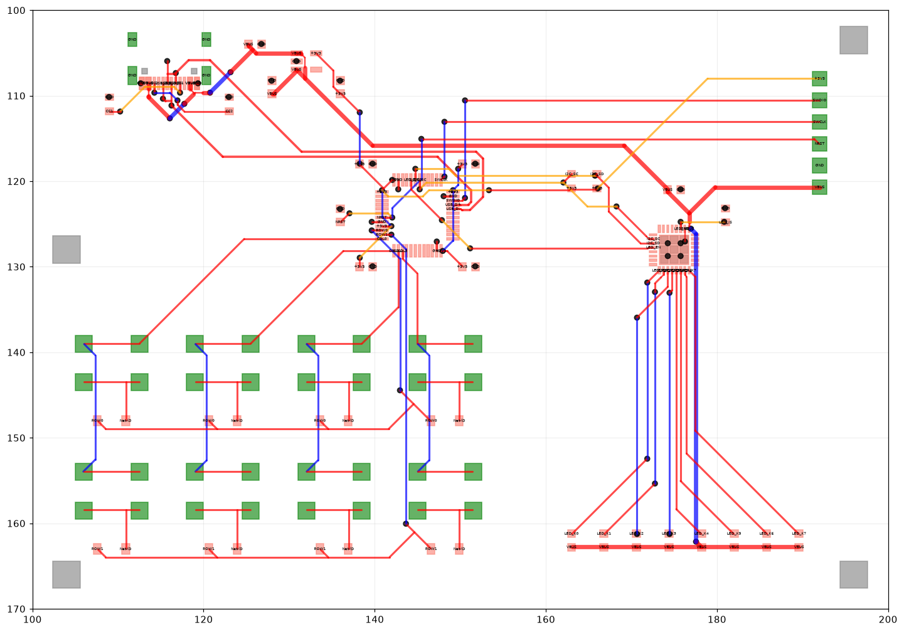

# Ultimate Kicad Autorouter

Автотрассировщик печатных плат KiCad: октолинейный A* (трассы только под 0/45/90°) с согласованием перегрузки
(PathFinder), шинами, дифпарами, шириной трасс по току и проверкой результата DRC самого KiCad.

*An octilinear (0/45/90°) autorouter for 4-layer KiCad boards: PathFinder negotiated congestion, bus lanes,
impedance-matched differential pairs, current-based track widths, power polygons with IR-drop analysis,
and a KiCad DRC feedback loop.*



## Быстрый старт

Нужны Python 3.10+ (`pip install -r requirements.txt`) и, для проверки DRC, KiCad 8+ (`kicad-cli`).

```bash
build.bat                                          # ядро A* (Windows; Linux/macOS — build.sh)
python route_board.py boards/demo.toml out/demo    # трассировка → плата → DRC KiCad → отчёт
```

Результат: `out/demo_routed.kicad_pcb` (зоны залиты KiCad), `out/demo_report.md` и `.json`.
Без C-компилятора: `pip install ziglang`, затем `build.bat` — он сам найдёт GCC, Clang, MSVC или zig.

## Тестовая плата

`example/demo_board.kicad_pcb` собирается скриптом `tools/make_demo_board.py` только из стандартных библиотек
KiCad (запуск — Python из комплекта KiCad). 100 × 70 мм, 4 слоя, 47 футпринтов, 36 цепей:
MCU в LQFP-48, драйвер светодиодов в QFN-32 с открытой площадкой, USB-C с дифпарой D+/D−, LDO 3,3 В,
матрица кнопок 2 × 4 с диодами, шина из 8 светодиодов, разъём питания/SWD.

Результат на ней (`out/demo_report.md`):

| | |
|---|---|
| Неразведено | 0 |
| Нарушений зазоров / обрывов (своя проверка) | 0 / 0 |
| DRC KiCad по трассировке | 2 замечания `starved_thermal` (терморазгрузка у GND-выводов), остальное — шелкография |
| Отрезков не под 0/45/90° | 1 |
| Переходов | 71 |
| Падение напряжения VBUS по меди (1,31 А) | 37 мВ — 0,74 % |
| Время | ~75 с вместе с DRC |

## Как это работает

Порядок — от самых ограниченных цепей к самым свободным:

1. **Fanout и переходы под площадками.** Переходы под открытыми GND-площадками микросхем ставятся сеткой.
   Выводы GND и питания у микросхем с шагом ≤ 0,5 мм выводятся на переходы. Глубина перехода выбирается
   по загрузке: дальше от переходов соседей, чтобы между ними остался канал под трассу.
   Режим `fanout.mode = "all"` выводит на переходы все выводы (для плотных BGA/QFN).
2. **Дифпары.** Ширина и зазор подбираются под целевой Zdiff по стеку (`impedance.py`, IPC-2141).
   Пара идёт только по слою с опорной плоскостью. Второй проводник притягивается к первому на шаге w + s.
3. **Питание.** Ширина считается отдельно для каждого слоя по двум условиям: нагрев по IPC-2221 и падение
   напряжения 2 %. Цепи от 1 А дополнительно получают полигон вдоль трассы, его заливает KiCad.
4. **GND.** Каждая GND-площадка получает свой короткий широкий отвод на плоскость, переход ставится
   как можно ближе.
5. **Сигналы — PathFinder.** На время согласования цепи «мягкие»: могут перекрываться, но платят за чужую
   территорию. Цена растёт с каждым проходом, в местах конфликтов копится история, и цепи расходятся сами,
   без зависимости от порядка. Остаток конфликтов добивает точная проверка геометрии и rip-up.
6. **Постобработка.** Спрямление (1–2 отрезка 0/45/90° вместо «ступенек»), точный вход в центр площадки,
   слияние коллинеарных и перекрывающихся отрезков, обрезка висящих хвостов. Каждое действие принимается
   только при сохранении связности.
7. **DRC KiCad в цикле.** `kicad-cli` заливает зоны и проверяет плату. Замечания, которые исправляются
   трассировкой (терморазгрузка, зазоры, висящие трассы, обрывы), исправляются, и проверка повторяется.
   Сохраняется лучший вариант.
8. **Отчёт.** Качество (углы, изломы, обходы, параллельность шин), падение напряжения по реальной меди
   после заливки (сетка сопротивлений, решается методом конечных разностей) и длины проводников дифпар.

### Шины и матрицы

* **Топология цепи** — минимальное остовное дерево от вывода ведущей микросхемы: строки и столбцы матрицы
  идут цепочкой от элемента к элементу, без «звёзд».
* **Группы шин** определяются по именам (`COL0..3`, `ROW0..1`, `LED_K0..7`, …). Цепи группы разводятся подряд
  в порядке выводов микросхемы, и каждая притягивается к полосе на шаге «ширина + зазор» от соседей.
* **Коридоры выхода.** Перед каждым выводом микросхемы с мелким шагом зарезервирована короткая полоса.
  Чужие цепи могут пройти через неё, но платят за это, поэтому дифпара или питание, разведённые первыми,
  не замуровывают выводы соседей.

### Правила

Все числа берутся из платы и конфига, в коде их нет:
* контур — из `Edge.Cuts`;
* сетка трассировки 0,1 мм выравнивается по центрам выводов с мелким шагом;
* толщина меди — из стека платы, по умолчанию JLC04161H-7628;
* зазоры, ширины и переходы — из `.kicad_pro`;
* токи, источники и потребители питания, быстрые цепи и дифпары — из `boards/*.toml`.

Быстрые цепи ведутся только по слою, у которого ближайший слой меди — плоскость. В стеке 7628
у In2 до плоскости In1 1,065 мм, а до сигнального B — 0,21 мм, поэтому для быстрых цепей годится только F.Cu.
У своих площадок им разрешён короткий переход на другой слой (например, перескок D+ через D− под USB-C).

Принципы — сплошная земля, короткие широкие отводы на неё, широкое короткое питание, опорная плоскость
у быстрых сигналов — общепринятые, их же излагают Хоровиц и Хилл в «Искусстве схемотехники».
Числа взяты из IPC-2221, IPC-2141 и удельного сопротивления меди.

## Своя плата

Скопируйте `boards/demo.toml`, укажите в нём свою плату и задайте:
* `power.currents` / `power.loads` — токи. От них зависят ширины, полигоны и расчёт падения напряжения;
* `power.sources` — откуда втекает ток;
* `nets.fast`, `nets.diff_pairs` — быстрые цепи и пары с целевым импедансом;
* `fanout` — разъёмы, выводы которых тоже надо вывести на переходы.

Параметры поиска (`route2.py`: цены изломов и переходов, полосы, PathFinder) переопределяются без правки кода:
`set ROUTER_VIAC=80` перед запуском.

## Файлы

| Файл | Что делает |
|---|---|
| `route_board.py` | Полный цикл по конфигу платы. |
| `route2.py` | Маршрутизатор: поиск, PathFinder, шины, пары, fanout, коридоры выхода, спрямление, rip-up. |
| `astar.c` | Ядро поиска: октолинейный A* (слой, y, x, направление), карты цены клеток и переходов, проверка достижимости, буферы на поток. |
| `rules.py`, `config.py`, `impedance.py` | Правила, конфиг и автоопределение, расчёт импеданса. |
| `pipeline.py`, `power.py`, `diffpair.py` | Запись платы, полигоны и падение напряжения, DRC KiCad в цикле, отчёт, длины пар. |
| `merge.py`, `post.py`, `zones.py` | Постобработка с проверкой связности, заливки GND на внешних слоях. |
| `check.py`, `metrics.py`, `viz.py` | Проверка зазоров и связности, метрики качества, картинка. |
| `tools/make_demo_board.py` | Генератор тестовой платы. |

## Ограничения и что в работе

* Дифпары: перекос длин измеряется и выводится в отчёт, но пока не выравнивается автоматически.
  На тестовой плате он 6,8 мм (38 пс): для USB Full Speed это неважно, для High Speed — нет.
* PathFinder на плотных шинах сходится не до нуля: последние 3–4 конфликта добивает точный rip-up.
* `starved_thermal` у GND-выводов, зажатых сигнальными, может остаться: это правится расстановкой
  или правилом зоны.
* Сетка 0,1 мм: шаги выводов не кратные 0,05 мм выравниваются хуже.
