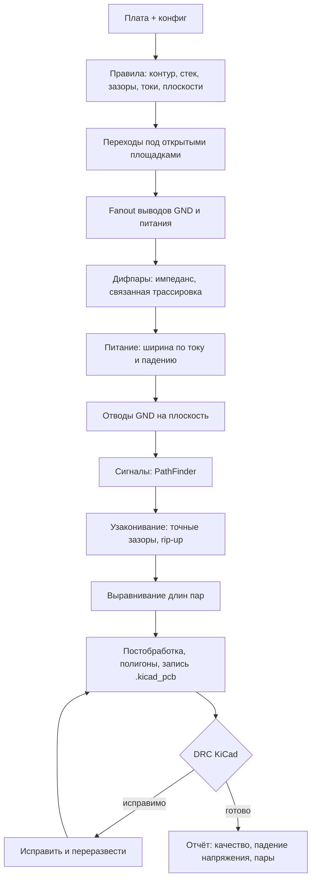

# Как это работает

## Этапы



Порядок — от самых ограниченных цепей к самым свободным: дифпары (один слой, связанная пара) раньше питания
(широкое, но может уйти на другой слой), питание раньше сигналов.

## Поиск пути

**Карты расстояний.** Для каждого слоя хранится расстояние от узла сетки до ближайшей меди и до второй ближайшей
цепи (с ограничением 1,2 мм). Клетка разрешена для трассы цепи шириной `w`, если до чужой меди не меньше
`зазор + w/2` и до края не меньше `край + w/2`.

**Ядро A\*** (`astar.c`). Состояние — (слой, y, x, направление прихода). Шаги в 8 направлений, разворот на 135°
и больше запрещён. Цена шага = длина × множитель направления слоя + штраф излома + карта цены клетки
(полоса шины, перегрузка, коридор выхода). Переход между слоями — в разрешённых клетках, по цене `VIAC` плюс
карта цены перехода. Эвристика — октильное расстояние до прямоугольника цели. При равной оценке выбирается узел
ближе к цели, поэтому поиск не растекается по равноценным зигзагам.

Перед A* — **проверка достижимости** обходом в ширину по клеткам без учёта направлений. Заведомо неудачный
поиск заканчивается за миллисекунды, а не после обхода всего окна. Буферы ядра свои у каждого потока
и переиспользуются между вызовами: состояние считается посещённым, только если его метка совпадает с номером
текущего поиска, так что обнулять сотни мегабайт не нужно.

**Окно поиска** растёт ступенями: 3, 8, 25, 80 мм вокруг источника и цели. Сначала цель — свой сосед
по дереву и трассы рядом с ним, потом любая точка цепи. Шина и пара сначала ищут путь по своей полосе.

## PathFinder

Сигнальные цепи на время согласования «мягкие»: их медь не препятствие, а **территория** — клетки ближе
`w/2 + зазор + w_сиг/2` к оси трассы (плюс 0,04 мм на срез угла диагональным шагом). Занятость клетки — сколько
чужих территорий её покрывает.

Цена клетки для цепи: `PF · занятость + история`; цена перехода — та же по всем слоям с расширением на радиус
перехода. После каждого прохода:

1. конфликты определяются **точно** — по реальной геометрии меди (shapely), а не по территории;
2. в клетках осей у конфликтов история растёт на `HINC`;
3. `PF` умножается на `PF_MUL` (потолок 50);
4. переразводятся только цепи с конфликтами.

Цепи расходятся сами, без перебора порядка. Остановка — без конфликтов, по лимиту проходов или после 5 проходов
без улучшения. Затем все цепи становятся жёсткими, остаток конфликтов переразводится, а то, что не развелось,
идёт в **rip-up**: путь ищется сквозь чужие трассы между разными связными частями цепи, мешающие цепи
снимаются и переразводятся. Круг жертв расширяется от попытки к попытке, питание и пары снимаются в последнюю
очередь. Если питание при этом сузилось бы до сигнальной ширины, итерация откатывается.

## Шины и полосы

Карта полосы для цепи из группы: в радиусе `LANE_R` от уже проложенных соседей цена растёт линейно с отклонением
от шага `w/2 + зазор + w_сос/2 + 0,06`, за его пределами — постоянная `LANE_COST`. Шаг полосы — сразу за
границей территории соседа, иначе полоса тянула бы цепь в конфликт с PathFinder. Для дифпары то же самое
с шагом `w + s` и ценой `PAIR_COST`.

## Ширина трасс

Для каждого слоя `l` с толщиной меди `t`:

```
нагрев (IPC-2221):  I = k · ΔT^0.44 · A^0.725,  A — сечение в mil², k = 0.048 снаружи, 0.024 внутри, ΔT = 10 °C
падение:            w ≥ ρ · L · (I/2) / (t · 0.02 · V),   ρ = 1.72e-8 Ом·м,  L = 1.2 × полупериметр площадок цепи
ширина = max(сигнальная, нагрев, падение), округление вверх до 0.05 мм, не больше 1 мм
```

Ток делится на 2, потому что нагрузки распределены вдоль цепи. 35 мкм меди — около 0,5 мОм на квадрат.

## Импеданс дифпары

IPC-2141 / Wadell, точность ±5–10 %:

```
Z0    = 87 / sqrt(εr + 1.41) · ln(5.98 · h / (0.8 · w + t))
Zdiff = 2 · Z0 · (1 − 0.48 · exp(−0.96 · s / h))
```

`h` и εr — диэлектрик до опорной плоскости. Перебор `w` и `s` с шагом 0,005 мм, минимальная ошибка, при равной —
более узкий зазор. Задержка — `sqrt(εeff) / c`, εeff ≈ 0,475·εr + 0,67. Для серийного изделия импеданс стоит
заказать у производителя по его расчёту стека.

## Падение напряжения по меди

После заливки зон KiCad медь цепи на каждом слое растрируется с шагом 0,1 мм. Соседние клетки соединены
проводимостью `t/ρ` (сопротивление квадрата). Слои связаны переходами и штыревыми площадками: стенка металлизации
25 мкм, толщина платы 1,6 мм. Площадки источника — 0 В, в площадки потребителей втекает их ток. Система
уравнений Кирхгофа (разреженная) решается scipy. В отчёт идут падение на каждом потребителе и максимум в мВ
и процентах номинала.

## Постобработка

Каждое действие принимается, только если не рвёт связность цепи.

* Перекрывающиеся коллинеарные отрезки одной цепи сливаются в один.
* Цепочки коллинеарных отрезков без ответвлений — в один отрезок.
* Близкие переходы одной цепи объединяются перемычкой 0/45/90°.
* Переходы, к которым трассы подходят меньше чем с двух слоёв, удаляются.
* Висящий конец отрезка укорачивается до ближайшей точки подключения (площадка, Т-примыкание, переход),
  иначе отрезок удаляется.

## DRC KiCad в цикле

Плата пишется, `kicad-cli pcb drc --refill-zones --save-board --format json` проверяет её. Замечания по
трассировке (зазоры, отверстия, край, висящие трассы и переходы, обрывы, `starved_thermal`) исправляются:

* `starved_thermal` — у GND-площадки растёт отступ чужих трасс (+0,2 мм за проход), цепи рядом переразводятся;
* остальное — переразводятся цепи из описания замечания.

До `drc.iters` повторов; на выходе — вариант с наименьшим числом замечаний по трассировке.

## Источники

* IPC-2221 — ширина проводника по току и нагреву.
* IPC-2141, Wadell «Transmission Line Design Handbook» — импеданс микрополоска и связанной пары.
* L. McMurchie, C. Ebeling, «PathFinder: A Negotiation-Based Performance-Driven Router for FPGAs», 1995.
* P. Horowitz, W. Hill, «The Art of Electronics» — общие принципы разводки: сплошная земля, короткие широкие
  отводы, опорная плоскость у быстрых сигналов.
