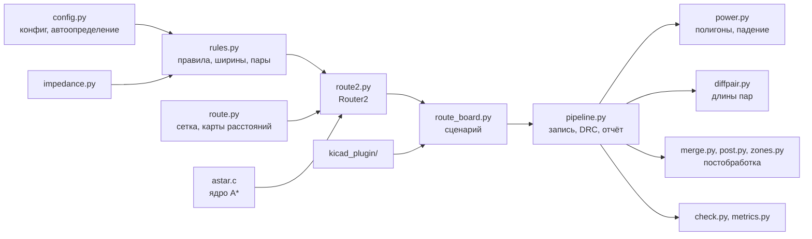

# Разработка

## Устройство кода



| Файл | Что делает |
|---|---|
| `route_board.py` | Полный цикл: `route()` — трассировка по этапам, `rip_up()` — запасная переразводка |
| `route2.py` | `Router2`: карты, поиск, PathFinder (`negotiate`, `conflicts`, `_congestion`), полосы (`_lane`), пары (`_pair_arg`), коридоры выхода, fanout, спрямление (`smooth`), запись (`commit`, `align`), rip-up (`blockers`, `split`), `violations`, `emit` |
| `astar.c` | Ядро A* (C99, буферы на поток) |
| `rules.py` | `Rules`: контур, стек, плоскости, `.kicad_pro`, токи, ширины, быстрые слои, пары; `bus_groups` |
| `config.py` | Загрузка TOML, `fanout_plan`, `thermal_vias` |
| `pipeline.py` | `write_board`, `kicad_drc`, `finish_and_check` (DRC-цикл), `report` |
| `power.py`, `diffpair.py`, `impedance.py` | Полигоны и падение напряжения, длины и выравнивание пар, импеданс |
| `merge.py`, `post.py`, `zones.py` | Постобработка, заливки GND на F/B |
| `board.py`, `sexp.py` | Чтение `.kicad_pcb` |
| `check.py`, `metrics.py`, `viz.py` | Проверка, метрики, картинка |

## Тесты

```bash
python -m pytest -q            # всё, около 2–3 минут
python -m pytest -q -m "not slow"   # 19 быстрых тестов за несколько секунд, без полной разводки
```

| Файл | Что проверяет |
|---|---|
| `test_rules.py` | IPC-2221 (1 А на 1 oz ≈ 0,30 мм), внутренний слой, ширина по падению, импеданс (≈ 92 Ом для 0,25/0,15 мм), подбор пары под 90 Ом, правила тестовой платы |
| `test_core.py` | A*: прямой путь, обход стены, «нет пути», переход между слоями, обход дорогих клеток, диагональ без зигзага |
| `test_post.py` | Слияние перекрытий, узлы не сливаются, цепочки, обрезка хвостов, связность |
| `test_board.py` | Автоопределение; полная разводка тестовой платы: 0 неразведённых, 0 нарушений, 0 обрывов, 0 косых отрезков, обход < 1,2, переходов < 120, шина LED_K ≥ 40 % параллельно, перекос пары в допуске; DRC KiCad без нарушений по трассировке, падение VBUS < 2 % |
| `test_kicad_plugin.py` | Плагин через Python KiCad и проверка `kicad-cli` |

Тесты KiCad пропускаются, если KiCad не установлен.

## CI

`.github/workflows/ci.yml`: Linux и Windows, Python 3.12. Шаги: зависимости → сборка ядра (`build.sh` /
`build.bat`) → проверка, что ядро загружается → `pytest -q -rfEs`. В CI нет KiCad, поэтому тесты DRC и плагина
пропускаются.

## Своя плата

1. Скопируйте `boards/demo.toml`, в `[board] file` укажите свою плату. Нужны 4 слоя меди и зона GND на In1.
2. Задайте токи (`power.currents` или `power.loads`), источники (`power.sources`), быстрые цепи и пары.
   Остальное подхватится с платы и `.kicad_pro`.
3. `python route_board.py boards/my.toml out/my` и смотрите `out/my_report.md`.
4. Если не всё развелось — посмотрите картинку (`viz.py`) и подвиньте расстановку: трассировщик не двигает
   компоненты. Типичные причины: вывод замурован соседями, разъём с чередующимися выводами без места под
   переход, питание и пара на одном слое.

## Сборка без компилятора

`pip install ziglang`, затем `build.bat` или `build.sh`: zig собирает DLL без внешних зависимостей. MinGW GCC
линкуется статически (`-static`): иначе `__thread` тянет `libwinpthread-1.dll`.
